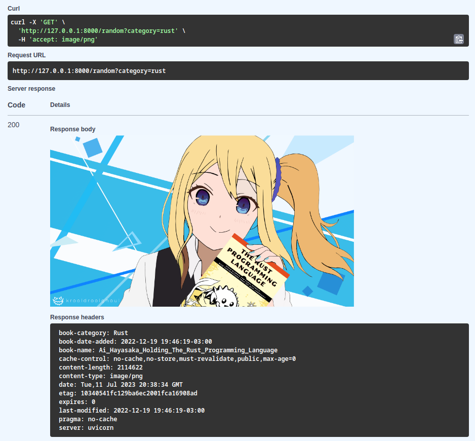

<div align="center">

  # 📚 AGHPB API

  <sub>Behold the **anime girls holding programming books** API!</sub>

  [](https://hub.docker.com/r/devgoldy/aghpb_api "We're on docker!")

</div>

This is an API I made for the anime girls holding programming books [github repo](https://github.com/cat-milk/Anime-Girls-Holding-Programming-Books) because I was bored.
It's a rewrite of the [old API](https://github.com/THEGOLDENPRO/aghpb_api_legacy) but written in Python using the [Fast API](https://github.com/tiangolo/fastapi) library instead.
It scrapes a local copy of the repo and thanks to that I was able to implement headers like ``Book-Date-Added`` (returns the date and time a book was added).



> oh yeah also check out our 🌟 cousin API **(anime girls and computers)**: https://github.com/r3tr0ananas/agac-api

## 🌐 Publicly available instances
Pick the closest instance to you for FASTER ANIME GIRLS!

| Country | URL | Hosted by | Notes |
|:-----------:|-------|:-------------:|:---------:|
| 🇬🇧 | [``https://api.devgoldy.xyz/aghpb/v1``](https://api.devgoldy.xyz/aghpb/v1) | [me](https://github.com/THEGOLDENPRO) | ⭐ Official Instance |
| 🇸🇪 | [``https://aghpb.zeeraa.net``](https://aghpb.zeeraa.net) | [Zeeraa](https://github.com/AntonUden) |
| 🇫🇷 | [``https://aghpb.thenolle.com``](https://aghpb.thenolle.com) | [Nolly](https://github.com/thenolle) |
| 🇩🇪 | [``https://aghpb.amoe.cloud``](https://aghpb.amoe.cloud) | [Ananas](https://github.com/ananasmoe) |

> You can also use these instances as backups in case my servers at https://api.devgoldy.xyz go down.

## 💫 API Wrappers
I was also even more bored so I decided to write an API wrapper in every mfing language I can possible, including those I've never really written in.

These are the languages I've written so far:
- **🦀 Rust - [``aghpb.rs``](https://github.com/THEGOLDENPRO/aghpb.rs)** (async)
- **🟦 TypeScript - [``aghpb.ts``](https://github.com/THEGOLDENPRO/aghpb.ts)** (async)
- **⚫ C - [``aghpb.c``](https://github.com/THEGOLDENPRO/aghpb.c)** ~~(might blow up)~~
- **🌕 Lua - [``aghpb.lua``](https://github.com/THEGOLDENPRO/aghpb.lua)**

Then here are some community-made api wrappers **( thanks 💛 )**:
- **☕ Java - [``AGHPB4J``](https://github.com/JoshiCodes/AGHPB4J)**

## 🖥️ Clients
Some fellow developers in the community also got bored so they made some clients:
- [AGHPB Frontend Web Page](https://aghpb.thenolle.com/browse/) ~ *Bringing anime girls holding programming books to your browser!*


- [AGHPB Vencord Plugin](https://github.com/thenolle/vencord-plugins/tree/master/aghpb) ~ *A vencord command to send anime girls holding programming books directly from your discord client.*


## 🛠️ Wanna self-host?
A short and quick guide on hosting your own instance of AGHPB API...

### 🐬 Docker
> [!note]
> If you're not on an **x86** architecture, you will need to build an image instead as our docker image currently does not support other architectures.

Hosting an instance of the AGHPB API is straightforward and recommended with Docker:

1. Pull our docker image.
```sh
docker pull devgoldy/aghpb_api:latest
```

> Or build the image yourself from source:
> 
> ```sh
> git clone https://github.com/THEGOLDENPRO/aghpb-api
> cd aghpb-api
> 
> docker buildx build -t devgoldy/aghpb_api:latest .
> ```

2. You can use docker run to spin up a quick container on `localhost` port `8000`.
```sh
docker run -p 127.0.0.1:8000:8000/tcp devgoldy/aghpb_api:latest
```
3. Now you can visit ``localhost:8000`` in your browser and the API docs should be up! 👍

### 📦 Docker Compose
You can also spin it up as a service in docker compose with the yaml below:

```yaml
aghpb-api:
    image: devgoldy/aghpb_api:latest
    ports:
        - 8000:8000
```

> [!note]
> If you're not on an **x86** architecture, you will need to build the image instead:
> ```yaml
> aghpb-api:
>     build: https://github.com/THEGOLDENPRO/aghpb-api.git#v1.4.17
>     ports:
>         - 8000:8000
> ```
